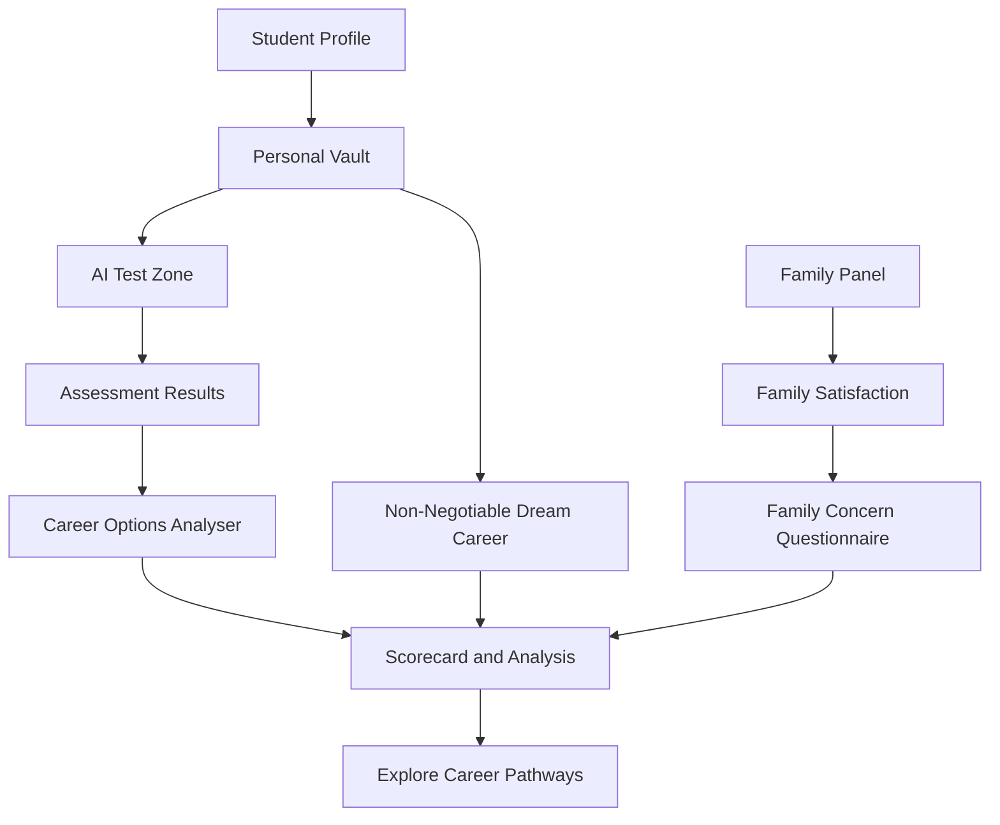
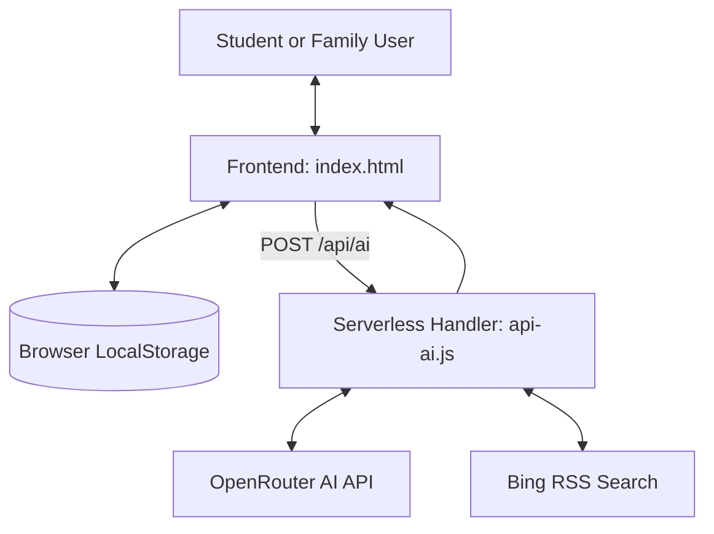

# CareerMitra 🎓

### AI-Powered Career Guidance, Built Around the Student and Family

**Your Career. Your Family. One Clearer Decision.**

CareerMitra is an AI-enabled career guidance and decision-support platform designed to help students discover career possibilities, understand their strengths, explore real-world opportunities, and make informed decisions with their families.

By combining personalized student profiles, structured self-assessments, career exploration, family perspectives, and AI-assisted research, CareerMitra aims to bridge the gap between what students aspire to become and what families need to understand before supporting that journey.

Career decisions should not be reduced to a test score, a salary estimate, or someone else's expectations. CareerMitra is built around a different principle: **help students explore their ambitions, understand the realities, and make better-informed decisions together.**

---

## 📑 Contents

- [Why CareerMitra?](#-why-careermitra)
- [Our Approach](#-our-approach)
- [Key Features](#-key-features)
- [The CareerMitra Journey](#-the-careermitra-journey)
- [The Non-Negotiable Dream Career](#-the-non-negotiable-dream-career)
- [Who Is CareerMitra For?](#-who-is-careermitra-for)
- [Technology Stack](#-technology-stack)
- [Architecture](#-architecture)
- [Getting Started](#-getting-started)
- [AI Configuration](#-ai-configuration)
- [Current Implementation Status](#-current-implementation-status)
- [Roadmap](#-roadmap)
- [Privacy and Security](#-privacy-and-security)
- [Contributing](#-contributing)
- [License](#-license)

---

## 🎯 Why CareerMitra?

Choosing a career is one of the most consequential decisions in a student's life. Yet the process can be confusing, especially when personal interests, academic performance, financial circumstances, family expectations, and employment prospects point in different directions.

Students may experience:

- **Uncertainty about their strengths:** Difficulty identifying interests, skills, and suitable career paths.
- **Information gaps:** Limited understanding of qualifications, educational pathways, costs, and employment opportunities.
- **Conflicting expectations:** Differences between a student's ambitions and their family's concerns about financial stability or long-term prospects.
- **Pressure from conventional choices:** A tendency to prioritize familiar career paths without adequately exploring alternatives.
- **Unclear next steps:** Difficulty converting a career aspiration into a practical education and skill-development plan.

CareerMitra aims to bring these considerations into one structured process, helping students and families move from uncertainty toward informed exploration.

## 💡 Our Approach

CareerMitra follows a four-stage framework:

**UNDERSTAND → ASSESS → INVOLVE → EXPLORE**

### 1. Understand

Build a clearer picture of the student through their educational background, interests, hobbies, preferred subjects, skills, career preferences, and personal aspirations.

### 2. Assess

Use structured questions and prototype assessment logic to explore personality-related preferences, Holland RIASEC traits, and reasoning.

### 3. Involve

Give family members a structured way to understand the student's interests, communicate their concerns, and participate in career discussions.

### 4. Explore

Examine potential career pathways, investigate the student's dream career, and identify areas of agreement and disagreement that deserve further consideration.

The objective is not to automate a life decision. It is to make the decision-making process more informed, transparent, and collaborative.

---

## ✨ Key Features

### 👤 1. Personalized Student Profile

CareerMitra supports different educational stages so that career exploration can reflect a student's current circumstances.

Supported profile stages include:

- Class 6–10.
- After Class 10.
- After Class 12.
- Undergraduate.
- Graduate.
- Postgraduate.

Profile fields adapt to the selected stage and can include relevant academic information, educational goals, and personal details.

### 🗂️ 2. Personal Vault

The Personal Vault acts as a structured record of a student's interests, preferences, skills, and aspirations.

It includes:

- Interests and hobbies.
- Personal likes and preferences.
- Subject strengths and self-assessments.
- Preferred career roles and sectors.
- Skills and supporting certificate files.
- Chosen fields and reasons for choosing them.
- Alternative career interests.
- Non-Negotiable Dream Career.

This information provides context for assessment questions and career exploration rather than treating every student as having the same needs.

### 🧠 3. AI Test Zone

The Test Zone provides an interactive, 25-question multiple-choice assessment.

Its implemented question framework covers:

- Personality-related preferences.
- Situational responses.
- Interests and preferences.
- Basic reasoning.
- Subject and skill-related questions.
- Career opinions and trade-offs.

The prototype calculates Holland RIASEC trait tallies and a separate reasoning score. AI-assisted question generation is also implemented in the code, with a local question-generation fallback.

**Important:** The assessment uses prototype-level heuristic logic. It has not been established as a professionally validated psychometric instrument and should not be used as the sole basis for high-stakes educational or career decisions.

### 🧭 4. Career Options Analyser

The Options Analyser presents career-option cards intended to help students investigate and compare potential pathways.

Depending on the available career data and successful AI responses, the information can cover:

- Career fit indicators.
- Connections to student interests and preferences.
- Potential advantages and challenges.
- Educational and qualification pathways.
- Relevant skills and certifications.
- Indicative earning ranges.
- Market considerations and future outlook.
- Alternative career options.
- Practical cautions and areas requiring verification.

The quality and availability of AI-dependent recommendations depend on backend configuration and external service availability.

### ⭐ 5. Non-Negotiable Dream Career

**A student's ambition should not disappear simply because an assessment ranks another career more highly.**

CareerMitra gives the student's chosen dream career a dedicated place in the application, separate from test-ranked career recommendations.

This feature is designed to help students:

- Preserve their stated aspirations during career exploration.
- Investigate educational requirements and practical pathways.
- Understand possible challenges, costs, and opportunities.
- Consider family concerns without automatically surrendering their personal goals.

The platform aims to encourage realistic planning without treating a student's ambition as something an algorithm should silently replace.

### 👨‍👩‍👧 6. Family Panel

Career decisions often involve the people who provide emotional, educational, and financial support. The Family Panel is designed to make their participation more structured.

Implemented workflows include:

- Family profile entry.
- Student linking-code entry.
- Reviewing student information.
- Recording satisfaction on a scale of 1–10.
- Answering a structured questionnaire about concerns.
- Saving responses for subsequent analysis.

The current implementation uses browser-local storage. Family linking therefore does not provide genuine synchronization between separate devices.

### 🤝 7. Scorecard and Common Ground Analysis

The Scorecard combines available student and family information to highlight potential areas of agreement and disagreement.

The prototype includes:

- A combined student-family scorecard.
- Analysis of family concerns across multiple dimensions.
- Career-option comparison logic.
- Identification of conflicting concerns.
- A mechanism to avoid forcing unsupported career recommendations into the common-ground results.

The resulting analysis is a decision-support aid, not a guarantee of career suitability, admission, employment, or financial success.

### 🔎 8. AI-Assisted Career Research

The backend contains an OpenRouter integration for AI requests and a Bing RSS-based search mechanism for retrieving career-related information.

The research logic is designed to prioritize relevant Indian educational and regulatory sources where applicable and associate research findings with retrieved source URLs.

This functionality requires a correctly configured backend and working external services. Live research and source quality have not been independently verified for every workflow.

### 🧪 9. Interactive Demo Mode

An in-memory demonstration workflow allows users to explore sample student and family journeys.

Demo data is illustrative. It should not be interpreted as real user information, verified assessment outcomes, or evidence of measured impact.

---

## 🔄 The CareerMitra Journey



The workflow connects student preferences, assessment findings, family perspectives, and career information while keeping the student's personal aspirations visible throughout the process.

---

## 🌟 The Non-Negotiable Dream Career

CareerMitra is built around an important distinction: **career assessment should inform a student's choices, not automatically dictate them.**

The Non-Negotiable Dream Career is stored and presented separately from test-ranked roles. The application also contains logic to examine the student's chosen career against practical realities and family concerns.

This reflects three core principles:

1. **Student agency:** Personal aspirations deserve explicit consideration.
2. **Informed exploration:** Ambition should be supported by an understanding of qualifications, costs, opportunities, and challenges.
3. **Constructive family dialogue:** Concerns should be examined openly rather than ignored or allowed to automatically override the student's preferences.

CareerMitra aims to help students and families evaluate possibilities together without promising that any single career path is risk-free.

---

## 👥 Who Is CareerMitra For?

CareerMitra is designed around several groups involved in educational and career decisions.

| Audience | Intended value |
|---|---|
| School students | Explore interests and understand possible educational directions |
| Students after Class 10 | Compare academic streams and vocational alternatives |
| Students after Class 12 | Explore higher education and career pathways |
| Undergraduate students | Investigate specializations, skills, and career opportunities |
| Graduates | Consider employment, further studies, and alternative pathways |
| Postgraduate students | Explore specialist, research, and industry options |
| Parents and guardians | Understand student aspirations and express practical concerns |
| Career educators | Explore a structured framework for student-family career discussions |

These are intended audiences; effectiveness across these groups has not yet been established through formal user studies.

---

## 🛠️ Technology Stack

The current repository uses a lightweight, framework-free frontend and a separate AI integration handler.

| Layer | Technology | Purpose |
|---|---|---|
| Frontend | HTML5 | Application structure and screens |
| Styling | CSS3 | Layout, responsive styling, and themes |
| Application logic | Vanilla JavaScript (ES6+) | State, navigation, validation, assessments, and interactions |
| Browser storage | LocalStorage and SessionStorage | Local application records and session data |
| Cryptographic API | Web Crypto API | Client-side PBKDF2 password-hashing implementation |
| Backend | Node.js-compatible serverless handler | AI requests and research processing |
| AI gateway | OpenRouter API | AI-assisted assessments and analysis |
| Web research | Bing RSS search | Retrieval of career-related search results |
| Intended hosting | Vercel | Frontend and serverless API deployment |

The current implementation does not use React, Vite, Tailwind CSS, or a remote cloud database.

---

## 🏗️ Architecture

The repository currently consists of two principal application files.

```text
CareerMitra/
├── index.html    # Frontend, styles, application logic, and local persistence
├── api-ai.js     # AI integration and career-research handler
└── README.md     # Project documentation
```

### System Overview



### Frontend

The frontend is a single-page application implemented using native HTML, CSS, and JavaScript. It includes custom rendering, application state, navigation, form validation, assessment logic, family workflows, and local persistence.

### Backend and External Services

The `api-ai.js` file contains the serverless handler intended to process AI requests and retrieve career-related search results.

Its operation depends on external service credentials, serverless deployment configuration, and service availability.

### Data Storage

The application currently stores user and family records in browser storage. There is no shared cloud database or remote synchronization layer in the audited repository.

---

## 🚀 Getting Started

### Prerequisites

- A modern web browser.
- Node.js and npm for the optional local HTTP server.
- An OpenRouter API key for AI-dependent functionality.
- A compatible serverless environment for testing the backend.

### 1. Clone the Repository

```bash
git clone https://github.com/PrinceJ18/CareerMitra.git
cd CareerMitra
```

### 2. Run the Frontend

For a quick interface preview, open `index.html` in a modern browser.

Alternatively, start a local static server:

```bash
npx serve .
```

Open the local URL printed by the command.

**Note:** A static server can display the frontend, but it does not automatically configure the `/api/ai` backend. AI-dependent workflows require a functioning backend deployment or compatible local serverless setup.

### 3. Configure the Backend

The serverless handler requires environment configuration for OpenRouter. See the next section.

Before deploying, verify the API route configuration and the server's module/runtime setup. The current repository audit identified missing serverless routing and package configuration that may prevent the AI endpoint from working as intended.

---

## 🔑 AI Configuration

The backend is designed to use these environment variables:

| Variable | Required | Description |
|---|---|---|
| `OPENROUTER_API_KEY` | Yes, for AI requests | Secret key used to authenticate with OpenRouter |
| `OPENROUTER_MODEL` | No | Overrides the configured default AI model |
| `SITE_URL` | No | Application URL used for request metadata |

Keep all API keys and secrets outside source control. Do not embed private credentials in frontend JavaScript or commit them to GitHub.

### Deployment Considerations

The frontend calls `/api/ai`, while the current `api-ai.js` file is located in the repository root. A standard Vercel setup generally expects serverless functions under an `api/` directory unless routing is configured explicitly.

The repository audit also found no `package.json` or `vercel.json`.

These configuration gaps should be resolved and the deployed endpoint tested before considering AI functionality production-ready.

---

## 📊 Current Implementation Status

CareerMitra is an evolving prototype. The following table distinguishes implemented application flows from capabilities that still require development or verification.

| Capability | Current status |
|---|---|
| Student profiles | Implemented with local storage |
| Personal Vault | Implemented with local storage |
| Assessment interface | Implemented |
| Holland RIASEC tallying | Implemented using prototype heuristics |
| AI-generated assessments | Backend code exists; live operation requires verification |
| Career-option interface | Implemented; AI-dependent content requires backend availability |
| Dream career evaluation | Dedicated implementation exists |
| Family questionnaire | Implemented locally |
| Cross-device family collaboration | Not implemented |
| AI-assisted live career research | Backend code exists; deployment and live behavior require verification |
| Shared cloud database | Not implemented |
| Backup download | Existing implementation has a browser compatibility defect identified in the audit |
| Psychometric validation | Not established |
| Production security review | Further work required |

### Known Limitations

- **Browser-local data:** Records are tied to the browser's local storage and can be lost if that data is cleared.
- **No cloud synchronization:** Student and family records cannot currently synchronize between separate devices.
- **AI dependency:** AI-assisted features may be affected by credentials, service outages, rate limits, and model changes.
- **Assessment limitations:** The scoring logic is a prototype and is not established as a validated psychometric assessment.
- **Career information:** Salary estimates, qualifications, admission requirements, and employment prospects require verification against current, authoritative sources.
- **Security limitations:** Client-side account and data storage require further security engineering before production use with sensitive personal information.

---

## 🗺️ Roadmap

The following are potential development priorities, not claims about existing functionality.

### Platform Foundation
- [ ] Establish reliable backend routing and deployment configuration.
- [ ] Add automated tests for important user journeys.
- [ ] Improve error handling and runtime diagnostics.
- [ ] Repair and verify data backup and recovery.

### Data and Collaboration
- [ ] Introduce secure server-side data persistence.
- [ ] Enable authenticated student-family linking across devices.
- [ ] Implement access controls for student and family records.
- [ ] Improve account recovery and session management.

### AI and Career Intelligence
- [ ] Improve structured-output validation and failure handling.
- [ ] Strengthen source attribution and career-information verification.
- [ ] Add systematic evaluation of AI-generated career guidance.
- [ ] Investigate authoritative education and career data integrations.

### Accessibility and Quality
- [ ] Explore support for Hindi and other Indian languages.
- [ ] Improve accessibility and usability across devices.
- [ ] Evaluate the usefulness and fairness of assessment logic.
- [ ] Conduct structured user testing with students and families.

---

## 🔐 Privacy and Security

CareerMitra handles information that can be personal and potentially sensitive, including academic records, interests, family concerns, and account information.

The current prototype stores these records in browser-local storage and implements client-side password hashing. These mechanisms should not be interpreted as equivalent to a production-grade authentication and data-protection architecture.

Until the platform receives further security engineering:

- Avoid entering sensitive real-world information into public demonstrations.
- Do not use real API keys in frontend code.
- Do not commit credentials or private configuration files.
- Treat AI-generated career information as a starting point for further research.
- Verify educational, licensing, and employment requirements through authoritative sources.
- Do not rely on prototype assessment results as the sole basis for consequential decisions.

A future public release should include a security review, appropriate access controls, secure server-side persistence, data-retention policies, and clear privacy disclosures.

---

## 🤝 Contributing

CareerMitra aims to evolve into a more useful, accessible, and reliable career guidance platform.

Potential areas for contribution include:

- Improving usability and accessibility.
- Strengthening assessment and career-exploration logic.
- Improving career-information quality and source attribution.
- Developing secure family collaboration workflows.
- Expanding educational and career resources.
- Adding automated tests and documentation.

Before submitting changes, review the current implementation and distinguish verified behavior from planned functionality.

For substantial changes, open an issue or discussion first to describe the problem, proposed solution, and expected impact.

---

## 📄 License

No repository license has been verified in the current project state. Until a license is added, do not assume the repository grants permission for unrestricted reuse, modification, or redistribution.

---

## 🌱 Our Vision

CareerMitra aims to make career guidance more personal, practical, and collaborative.

We believe students should have the space to explore their ambitions, families should have a constructive way to express their concerns, and career decisions should be informed by evidence rather than pressure or assumptions.

**A career decision should not simply tell a student what to become. It should help them understand what they want to become, what it takes to get there, and how to move forward with confidence.**

**CareerMitra — Your Career. Your Family. One Clearer Decision.**