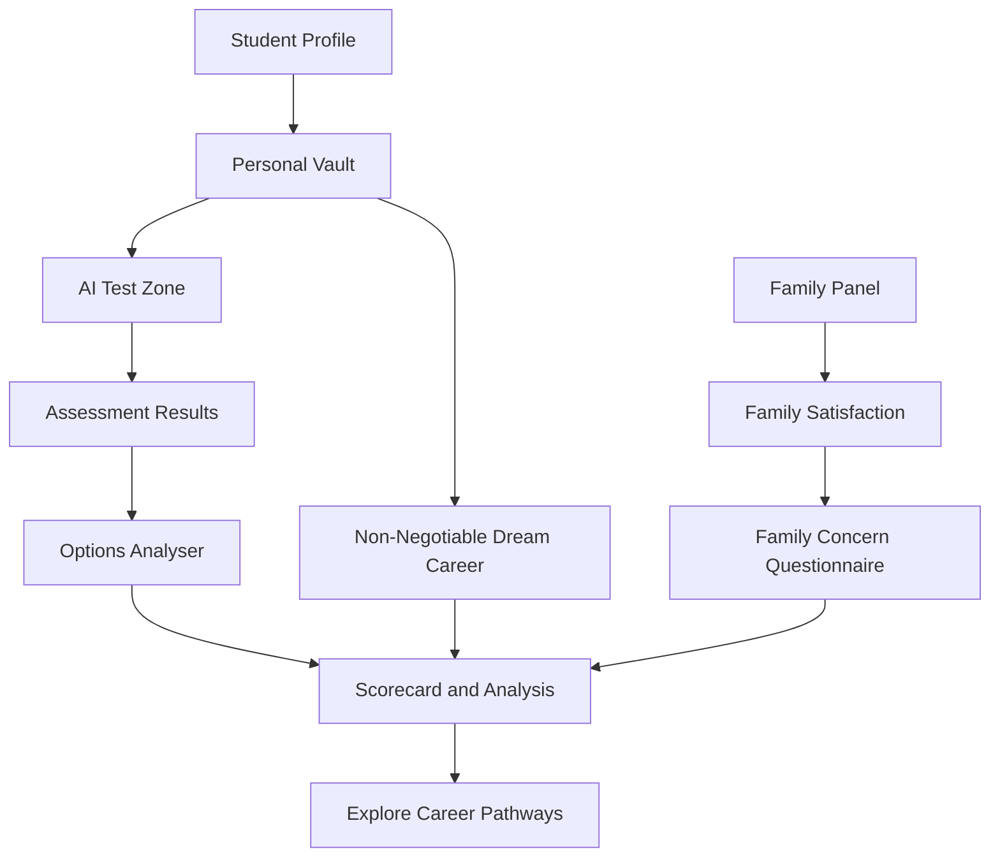
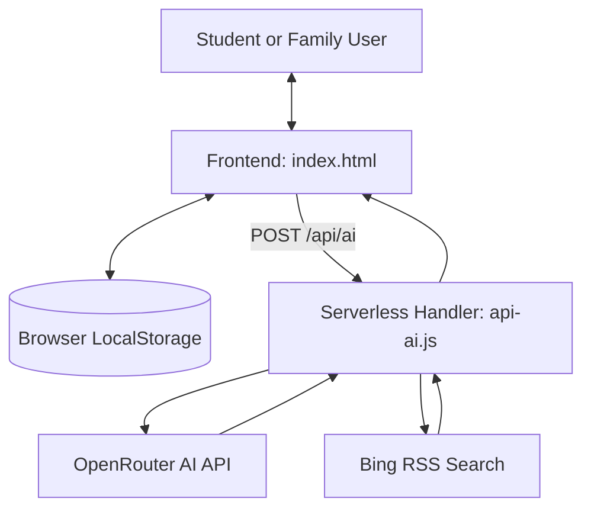

# CareerMitra

# CareerMitra 🎓
### AI-Enabled Career Counselling & Family Decision Support

**Your Career. Your Family. One Clearer Decision.**

CareerMitra is an AI-enabled career guidance and family decision-support platform designed for the Indian education system. It helps students explore suitable career pathways using their interests, skills, academic background, personal aspirations, and assessments while giving families a structured way to express their concerns and participate in career decisions.

Unlike conventional career quizzes that focus primarily on rankings, CareerMitra aims to bring student aspirations and family expectations together through personalized assessments, career research, and evidence-based decision support.

> **Smart India Hackathon 2026**
>
> - **Problem Statement ID:** SIH26241
> - **Theme:** Smart Education
> - **Category:** Software
> - **Team:** Code Combat
> - **Team ID:** 123380

---

## 📌 Table of Contents

- [The Problem](#-the-problem)
- [Our Solution](#-our-solution)
- [Key Features](#-key-features)
- [The CareerMitra Journey](#-the-careermitra-journey)
- [The Non-Negotiable Dream Career](#-the-non-negotiable-dream-career)
- [Technology Stack](#-technology-stack)
- [System Architecture](#-system-architecture)
- [Getting Started](#-getting-started)
- [AI Configuration](#-ai-configuration)
- [Current Implementation and Limitations](#-current-implementation-and-limitations)
- [Future Scope](#-future-scope)
- [Team](#-team)
- [License](#-license)

---

## 🎯 The Problem

Career decisions can be challenging for students and families, particularly when personal interests, academic performance, financial constraints, employment prospects, and family expectations do not align.

Common challenges include:

- **Limited self-awareness:** Students may struggle to identify their interests, strengths, and suitable career pathways.
- **Family disagreements:** Students and parents may have different expectations about education, financial stability, location, and long-term career prospects.
- **Incomplete career information:** Students may not understand qualification requirements, educational pathways, costs, or employment opportunities.
- **Overreliance on rankings:** A test result or recommendation may fail to reflect a student's individual aspirations.
- **Lack of structured discussion:** Career disagreements can become subjective arguments instead of informed conversations.

CareerMitra aims to address these challenges by making career exploration a structured, student-centred, and collaborative process.

## 💡 Our Solution

CareerMitra combines student profiling, a Personal Vault, assessments, career-option analysis, family feedback, and career research in one guided workflow.

The platform is built around four stages:

**UNDERSTAND → ASSESS → INVOLVE → EXPLORE**

- **Understand:** Capture the student's academic background, interests, preferences, skills, and aspirations.
- **Assess:** Use a personalized question-based assessment to explore Holland RIASEC traits and reasoning.
- **Involve:** Enable family members to review the student's information and communicate their concerns through a structured workflow.
- **Explore:** Compare career pathways, examine the student's dream career, and identify potential areas of agreement.

The goal is not to let an algorithm decide a student's future. It is to support more informed discussions and better-understood career choices.

---

## ✨ Key Features

### 👤 1. Stage-Adaptive Student Profile

Collects student information according to their educational stage, supporting:

- Class 6–10 students.
- Students choosing a stream after Class 10.
- Students exploring higher education after Class 12.
- Undergraduate students.
- Graduates.
- Postgraduate students.

The profile includes relevant academic and personal information to help contextualize career exploration.

### 🗂️ 2. Personal Vault

A structured space for students to record their individual preferences and supporting information.

The Personal Vault includes:

- Interests and hobbies.
- Personal likes and preferences.
- Subject strengths and self-assessments.
- Preferred career roles and sectors.
- Chosen fields and reasons for choosing them.
- Alternative career interests.
- Skills and supporting certificate files.
- Non-Negotiable Dream Career.

Vault information is used to contextualize assessment questions and career exploration.

### 🧠 3. AI Test Zone

An interactive assessment designed around the student's profile and Personal Vault.

Current implementation includes:

- A 25-question multiple-choice assessment.
- Personality and situational questions.
- Questions grounded in interests and preferences.
- Basic reasoning and subject-related questions.
- Holland RIASEC trait tallying.
- Local question-generation fallback when AI services are unavailable.

The assessment uses prototype-level heuristic scoring. It is intended to support self-exploration, not to replace a professionally validated psychometric assessment.

### 🧭 4. Options Analyser

Presents career-option cards to help students explore and compare potential pathways.

Depending on available data and AI responses, career information can cover:

- Career suitability indicators.
- Connections with recorded interests and preferences.
- Potential benefits and challenges.
- Educational and qualification pathways.
- Indicative pay ranges and market considerations.
- Relevant skills and certifications.
- Alternative career options.
- Important verification considerations.

AI-generated career recommendations depend on successful backend integration and external model availability.

### ⭐ 5. Non-Negotiable Dream Career

CareerMitra gives the student's chosen dream career its own dedicated place in the decision-making process.

The platform is designed to keep this aspiration separate from test-ranked career recommendations. Students can examine the practical realities of their chosen career without automatically having that aspiration replaced by a higher-scoring alternative.

Where the relevant AI research integration is operational, the platform can retrieve career-related information and source links to support further investigation.

### 👨‍👩‍👧 6. Family Panel

The Family Panel provides a structured way for family members to participate in career discussions.

Implemented workflows include:

- Family profile entry.
- Student linking-code workflow.
- Review of student information.
- A satisfaction rating from 1 to 10.
- A questionnaire for expressing concerns when further discussion is needed.
- Recording family responses for subsequent analysis.

**Current limitation:** Student and family records are stored in browser-local storage. Consequently, the current implementation does not provide genuine cross-device family collaboration.

### 🤝 7. Scorecard & Common Ground Analysis

Combines available student and family information to identify potential areas of agreement and disagreement.

The implementation includes:

- A combined student-family scorecard.
- Analysis of family concerns across multiple dimensions.
- Career-option comparison logic.
- Explicit handling of conflicting concerns.
- A mechanism for avoiding unsupported recommendations when sufficient evidence is unavailable.

The resulting analysis is a prototype decision-support aid, not a guarantee that a career will be successful or suitable.

### 🔬 8. AI-Assisted Career Research

The backend contains an integration with OpenRouter for AI requests and a Bing RSS-based search mechanism for retrieving career-related information.

The research logic is designed to prioritize relevant Indian educational and regulatory sources where applicable and associate findings with retrieved source URLs.

Live research requires the backend to be deployed correctly and configured with a valid API key. Its availability is subject to external services and model limitations.

### 🧪 9. Interactive Demo Mode

A demonstration workflow allows judges and testers to explore sample student and family journeys without having to populate every field manually.

Demo information is illustrative and should not be interpreted as real user data or measured project outcomes.

---

## 🔄 The CareerMitra Journey



The workflow is designed to connect student aspirations, assessment findings, family perspectives, and career information without treating any single score as the final answer.

---

## 🌟 The Non-Negotiable Dream Career

One of CareerMitra's defining design principles is that **a student's dream career should not be silently replaced by an algorithmic ranking**.

The platform treats the student's chosen career as a separate consideration rather than automatically treating it as the correct answer to an assessment.

This approach supports three goals:

1. **Respect personal ambition:** Preserve the student's stated aspiration as an explicit part of the decision.
2. **Encourage informed exploration:** Examine qualifications, pathways, opportunities, risks, and other practical considerations.
3. **Support family dialogue:** Consider family concerns alongside the student's aspirations rather than allowing either side to dominate automatically.

CareerMitra is intended to help students make informed decisions, not make those decisions on their behalf.

---

## 🛠️ Technology Stack

The current repository uses a lightweight, framework-free frontend with a separate AI integration handler.

| Layer | Technology | Purpose |
|---|---|---|
| Frontend structure | HTML5 | Application screens and markup |
| Styling | CSS3 | Responsive interface, themes, and layouts |
| Frontend logic | Vanilla JavaScript (ES6+) | State, navigation, validation, assessments, and interactions |
| Browser persistence | LocalStorage and SessionStorage | Local user records, application state, and session data |
| Client-side cryptography | Web Crypto API | PBKDF2 password-hashing implementation |
| Backend runtime | Node.js-compatible serverless handler | AI requests and career-research processing |
| AI gateway | OpenRouter API | AI-assisted assessments and analysis |
| Web research | Bing RSS search | Retrieval of career-related search results |
| Intended hosting | Vercel | Frontend hosting and serverless API deployment |

**Note:** React, Vite, Tailwind CSS, and a remote database are not part of the current repository implementation described in the audit.

---

## 🏗️ System Architecture

The current architecture consists of two primary source files.



### Repository Structure

```text
CareerMitra/
├── index.html    # Frontend, styles, application logic, and local persistence
├── api-ai.js     # AI integration and career-research handler
└── README.md     # Project documentation
```

The application currently stores user records and family-linking information locally in the browser. The AI handler is intended to run as a serverless function and communicate with external services.

---

## 🚀 Getting Started

### Prerequisites

- A modern web browser.
- A local HTTP server for browser-based development, recommended for testing.
- Node.js if using the optional local server command below.
- An OpenRouter API key if testing AI features through a correctly configured backend.

### 1. Clone the Repository

```bash
git clone https://github.com/PrinceJ18/CareerMitra.git
cd CareerMitra
```

### 2. Run the Frontend

For a quick UI preview, open `index.html` in your browser.

Alternatively, if Node.js and npm are installed, start a temporary static server:

```bash
npx serve .
```

Open the local URL printed by the command.

**Important:** Running the HTML frontend by itself does not establish that the `/api/ai` backend is operational. AI-dependent functionality requires a correctly configured serverless deployment or local backend environment.

---

## 🔑 AI Configuration

The backend is designed to use the following environment variables:

| Variable | Required | Purpose |
|---|---|---|
| `OPENROUTER_API_KEY` | Yes, for AI requests | Authenticates requests to OpenRouter |
| `OPENROUTER_MODEL` | No | Overrides the configured default AI model |
| `SITE_URL` | No | Provides the application URL for request metadata |

Never commit API keys or other credentials to the repository.

### Backend Deployment Note

The current audit identified a deployment configuration issue: `api-ai.js` is located in the repository root, while the frontend requests `/api/ai`.

A standard Vercel deployment generally expects serverless functions inside the `api/` directory, unless suitable routing is configured. The repository also lacks a `package.json` and `vercel.json` in its audited state.

Therefore, the API routing and module configuration should be corrected and tested before claiming that the deployed AI functionality is operational.

---

## ⚠️ Current Implementation and Limitations

CareerMitra is a functional prototype, but some production requirements remain outstanding.

| Area | Current status |
|---|---|
| Student profile and Personal Vault | Implemented using browser-local storage |
| Assessment interface and RIASEC scoring | Implemented with prototype-level heuristic logic |
| Career-option interface | Implemented; AI-dependent results require backend availability |
| Dream career evaluation | Dedicated implementation exists |
| Family concern collection | Implemented in the local application |
| Cross-device family linking | Not supported by the current local-storage architecture |
| AI-assisted career research | Backend code exists; deployment and live integration require verification |
| Cloud database synchronization | Not implemented |
| Automated psychometric validation | Not established |
| Backup download | Audit identified a browser compatibility defect requiring correction |
| Production security and privacy | Further engineering and validation required |

### Important Considerations

- **Local data:** Clearing browser data may remove locally stored application records.
- **Family collaboration:** Student and family data are not synchronized through a shared remote database.
- **AI availability:** External API rate limits, credentials, and model availability can affect AI-assisted workflows.
- **Assessment interpretation:** RIASEC scores and other prototype calculations should not be treated as scientifically validated diagnoses.
- **Career information:** Requirements, salary ranges, admissions, and employment prospects should be checked against authoritative and current sources.
- **Privacy:** The current client-side storage and authentication approach requires further security review before production use with sensitive personal information.

---

## 🗺️ Future Scope

Potential development priorities include:

1. **Cloud database integration:** Introduce secure server-side persistence for student and family records.
2. **Cross-device collaboration:** Enable family members to connect through a secure linking mechanism across separate devices.
3. **Deployment hardening:** Correct API routing, configure the serverless runtime, and verify production AI requests.
4. **Security improvements:** Strengthen authentication, authorization, rate limiting, and protection of personal data.
5. **Backup and recovery:** Repair and test data export and import workflows.
6. **AI reliability:** Improve validation, source attribution, failure handling, and the reliability of generated career information.
7. **Assessment evaluation:** Test the usefulness and fairness of prototype assessment logic before making stronger claims about career suitability.
8. **Indian-language accessibility:** Explore support for Hindi and other Indian languages.
9. **Institutional data integration:** Investigate reliable official data sources for admissions, qualifications, and career pathways.
10. **Testing and quality assurance:** Add automated tests and end-to-end verification for important user journeys.

These items represent potential future work, not claims of existing functionality.

---

## 👥 Team

**Team Code Combat**

- **Team ID:** 123380
- **Project:** CareerMitra
- **SIH Problem Statement:** SIH26241

CareerMitra is developed in the context of Smart India Hackathon 2026 under the Smart Education theme.

---

## 📄 License

No license has been verified in the current repository. Until a license is added, the project should not be assumed to grant permission for unrestricted reuse, modification, or redistribution.

---

## ❤️ Our Vision

We believe career guidance should help students understand themselves, explore real opportunities, and have better conversations with their families.

**CareerMitra aims to make career decisions more informed, collaborative, and centred on the student's aspirations.**

*Your Career. Your Family. One Clearer Decision.*